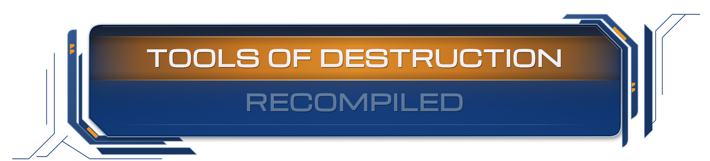
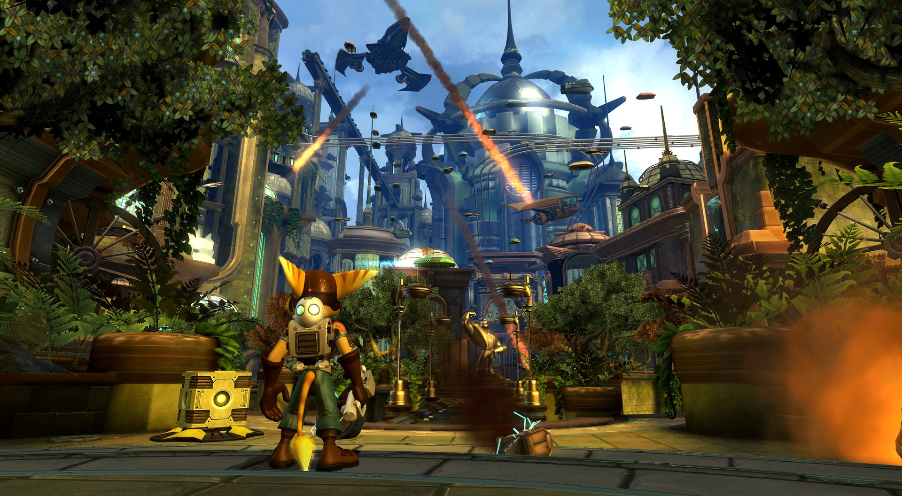
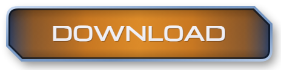
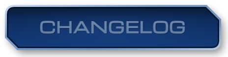
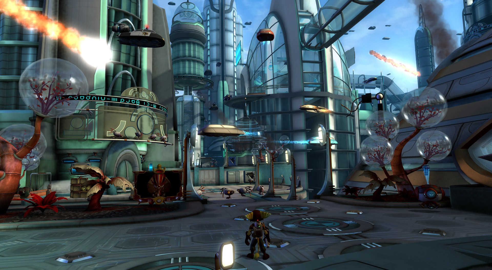
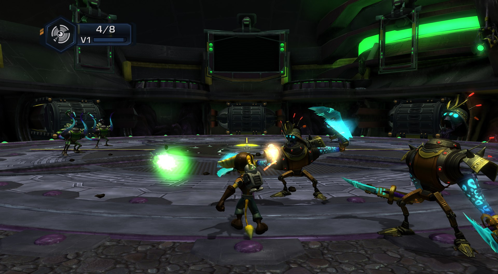
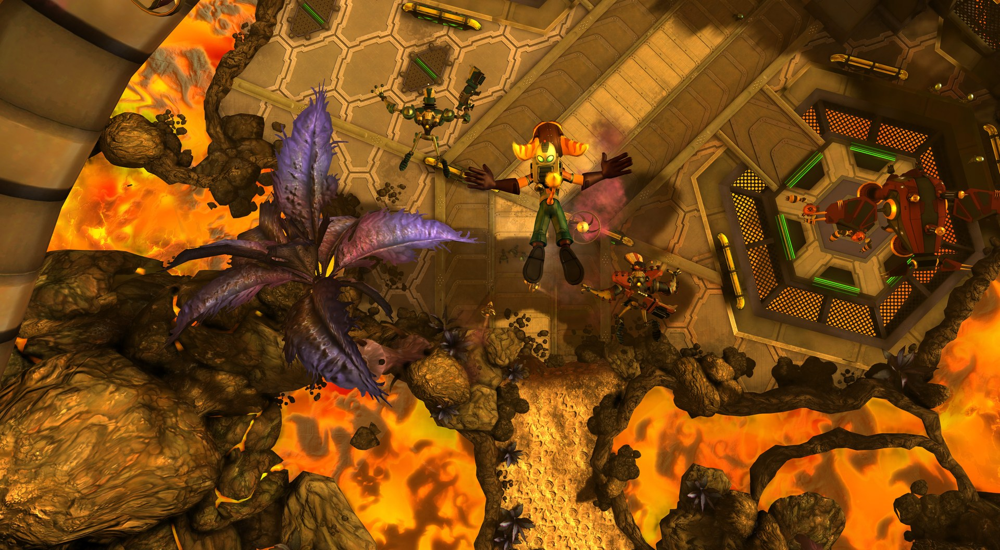
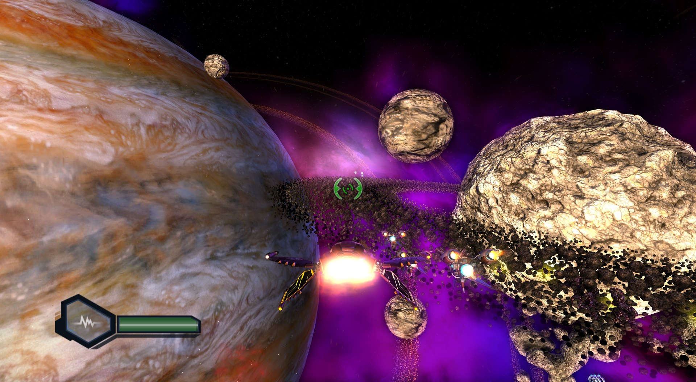
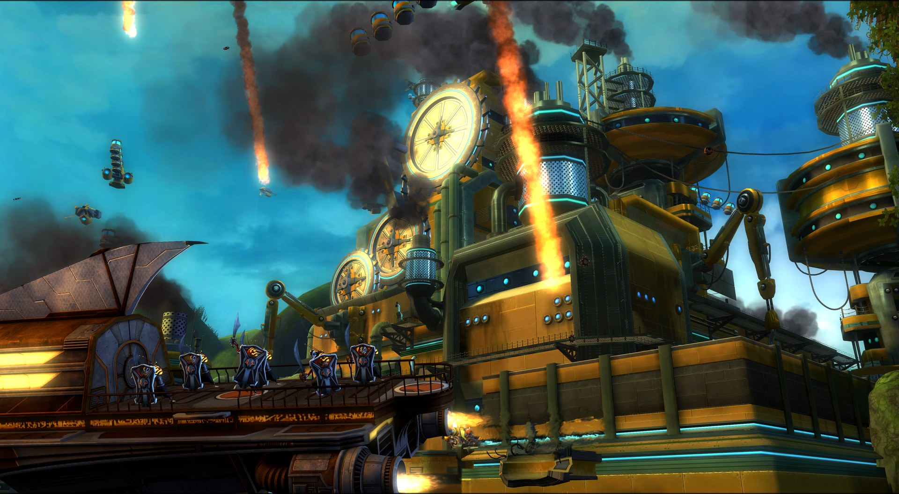
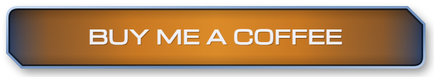

<a id="top"></a>
<div align="center">

<h1></h1>

**Ratchet & Clank: Tools of Destruction for PC** (*Ratchet & Clank Future: Tools of Destruction*):
a native Windows port of the PlayStation 3 game, built by static recompilation. No emulator,
Direct3D 12, up to 4K and 60 fps.


-lightgrey)


[](https://recomplauncher.com/game/ratchet-tod-recomp)
[](https://recompstore.com/dev/re-tero17)



<a href="https://github.com/Re-TeRo17/ratchet-tod-recomp/releases"></a>
<a href="#installing"></a>
<a href="#steam-deck--steamos-proton-community-guide"></a>

<a href="docs/FEATURES.md"></a>
<a href="#settings"></a>
<a href="CHANGELOG.md"></a>

<a href="#known-issues"></a>
<a href="#reporting-bugs"></a>
<a href="#support-the-project"></a>

<sub><a href="#whats-new-in-120">What's new</a> | <a href="#screenshots">Screenshots</a> | <a href="#quick-start">Quick start</a> | <a href="#requirements">Requirements</a> | <a href="#controls">Controls</a> | <a href="#status">Status</a> | <a href="#roadmap">Roadmap</a> | <a href="docs/BUILDING.md">Building</a> | <a href="#supporters">Supporters</a> | <a href="#credits">Credits</a></sub>

</div>

A native PC port of **Ratchet & Clank: Tools of Destruction** (Ratchet & Clank Future: Tools of
Destruction, PlayStation 3, European release **BCES00052**) for Windows, made by static
recompilation of the game's code on the [ps3recomp](https://github.com/sp00nznet/ps3recomp)
toolkit. The game's PowerPC (PPU) and SPU code is translated to C/C++ ahead of time and built into a
normal executable, with the PS3's system libraries replaced by native implementations and the RSX
graphics by Direct3D 12. There is no emulation at run time.

**Nothing of the game is in this download.** You need your own copy of the game (the disc). The
installer takes it from there.

**Version 1.2.1 is out** (8 November 2026): real ultrawide and the PC settings in the game's own
Options menu. See the [changelog](CHANGELOG.md). Thank you to the project's [supporters](#supporters)!
Version 1.2.0 (7 November 2026) made the frame rate much steadier. Version 1.1 (4 November 2026) added a save slot list and the
missing level voices. Version 1.0 was the first public release (2 November 2026; development started
on 20 October 2026). The game is playable from the first planet onwards, but it is not finished: see
[Status](#status) and [Known issues](#known-issues) before you start.

## What's new in 1.2.1

- **Real ultrawide.** At 21:9, 3440x1440 and 32:9 the game shows a wider view instead of a stretched
  picture; the HUD, the weapon wheel and the menus stay 16:9 in the middle. F1 > Video > Aspect ratio
  (or `TOD_ASPECT` in `tod.ini`); off by default.
- **The PC settings in the game's own Options menu**, from the main menu and the pause menu. The game
  prepares the menu from your copy at the first start; nothing else to install.
- A clearer notice when a new version is available, and Crop black bars in F1 > Video.

## What's new in 1.2.0

- **Much steadier frame rate.** The renderer works on several threads, the collision code runs
  natively and video memory use is about 0.8 GB lower at 4K with MSAA x8. In a heavy fight at Rykan V
  the average went from 47-51 to 57 fps and the seconds below 45 fps from 26-30% to 2-3%.
- **No stutter the first time an effect appears.** The shaders are built once, before you play (about
  25 s on the first start).
- **No more freezes on Intel 12th-14th gen CPUs** (the game runs on the P-cores).
- **A crash report plus a detailed log** to make bug reports easier.
- Already in 1.1: **pick your save slot**, and **the missing voices are back** (dialogue and ambient
  sound that some levels stream from separate files).

<sub><a href="#top">back to top</a></sub>

## Highlights

<a id="features"></a><a id="performance"></a>

- **Native, not emulated.** The game's code is recompiled ahead of time into a Windows executable.
- **Any resolution, and the 3D scene really is 4K.** The internal resolution is a free multiple of the
  game's 1280x720 (1080p, 1440p, 4K and beyond), with MSAA or FXAA and 16x anisotropic filtering. The
  game renders its 3D scene at 960x704 and stretches it afterwards; in 1.0 that stretch is undone, so
  the scene is sharp at 4K instead of being enlarged by a third in width.
- **A 60 fps target** (the original runs at 30 fps in many places). On a Ryzen 5 3600 + RTX 3070 at 4K
  with MSAA x8, 1.2.0 averages 59 fps on Cobalia, 57 in fights on Rykan V and on the Apogee Space
  Station, and 54 in the busiest fights in Metropolis (it was about 31 there in 1.0). Details:
  [Features: Performance](docs/FEATURES.md#performance) and [Known issues](#known-issues).
- **Character ground shadows are back**, with reworked shadow bias. Optional **ray-traced ambient
  occlusion** (experimental) on DXR 1.1 graphics cards.
- **In-game settings page** (F1, or hold SELECT on a controller): resolution, window mode, VSync, FPS
  limit, anti-aliasing, game language, button prompts, and a **Controls** tab to rebind every key and
  mouse button.
- **DualSense adaptive triggers** that follow the weapon in Ratchet's hands (click, heavy pull, rattle,
  flamethrower drag), with a kick at every shot; on by default, adjustable in F1.
- **In-game Cheats tab** (F1): god mode, infinite ammo, bolts, all weapons, the game's own cheats; off
  at every start.
- **One-click installer** that builds the game folder from your own decrypted disc dump and checks that
  it is the right disc. Nothing of the game is shipped.
- **Game language of your choice** (text, voices and subtitles that the disc offers), and button
  prompts that follow your controller: PlayStation 3/4/5, Xbox, Switch or keyboard.
- **Shaders built before you play:** the 1719 graphics pipelines the game uses are compiled once on the
  first start (about 25 s, with a progress window) and kept in `cache\`.
- **Discord Rich Presence**: the planet you are on and the time played, while Discord is running.
- **Ultrawide** (21:9, 3440x1440, 32:9; off by default, F1 > Video) and, experimental, the mouse camera (F1 >
  Controls); see
  [Features: Experimental options](docs/FEATURES.md#experimental-options-off-by-default).
- **Free and open source** (MIT). The repository holds the port's own code and the scripts to build it
  from your own disc.

The full list is in [docs/FEATURES.md](docs/FEATURES.md): graphics, performance (with the 1.2.0
numbers), audio and video, input, saves, mods folder.

<sub><a href="#top">back to top</a></sub>

## Screenshots

<table>
  <tr>
    <td width="50%"><br><sub><b>Metropolis (Kerwan)</b> - the opening city, under attack</sub></td>
    <td width="50%"><br><sub><b>Meridian City</b> - meteors over the capital</sub></td>
  </tr>
  <tr>
    <td width="50%"><br><sub><b>Imperial Fight Fest</b> - close combat in the arena</sub></td>
    <td width="50%"><br><sub><b>Rykan V</b> - the planet's fiery depths</sub></td>
  </tr>
  <tr>
    <td width="50%"><br><sub><b>Space combat</b> - a ringed gas giant and nebula</sub></td>
    <td width="50%"><br><sub><b>Kerchu City</b> - the pirate-raided city under fire</sub></td>
  </tr>
</table>

<sub>Captured at 3840x2160 internal 4K (RSX_SCALE=3), MSAA x8, 16x anisotropic filtering, then
downscaled and saved as JPEG for this page.</sub>

### Videos

<table>
  <tr>
    <td width="50%"><a href="https://www.youtube.com/watch?v=9Zxq7EdYPfs"></a><br><sub><b>4K with ray tracing</b> - RTX 5080 + Ryzen 7 9800X3D, by ANGEL4EVA</sub></td>
    <td width="50%"><a href="https://www.youtube.com/watch?v=scb1zhBkfrg"></a><br><sub><b>On an RTX 3070</b> - by danxo</sub></td>
  </tr>
  <tr>
    <td width="50%"><a href="https://www.youtube.com/watch?v=zkKoBaS6y6o"></a><br><sub><b>Review</b> - i9 12900K + RTX 3080 Ti, by Video Game Esoterica</sub></td>
    <td width="50%"></td>
  </tr>
</table>

<sub>These videos were recorded with the first versions (1.0 to 1.2.0). Made a video with the port? Open an issue with the
link and it can be added here.</sub>

<sub><a href="#top">back to top</a></sub>

## Quick start

1. **Download** `tod-recomp-1.2.1-win64.zip` from the
   [Releases](https://github.com/Re-TeRo17/ratchet-tod-recomp/releases) page and unzip it anywhere
   except `Program Files`.
2. Run **`Install.bat`**, pick your **decrypted** `.iso` or disc folder (European disc, BCES00052) and
   press **Install**.
3. Press **Play** (or run **`Play.bat`** any time later).
4. Press **F1** in the game for the settings page. Later, run **`Update.bat`** to get new versions.

More detail in [Installing](#installing); your disc must be one of the
[supported game files](#which-game-files-work).

## Requirements

| | |
|---|---|
| OS | Windows 10 or 11, 64-bit |
| CPU | **AVX2, FMA and BMI1/BMI2** (Intel Haswell / 4th gen Core or newer, any AMD Ryzen). On older CPUs the game shows a message at start saying the CPU is not supported. A fast 6+ core CPU matters most: the game's SPU code runs on your CPU cores. |
| GPU | Direct3D 12 (feature level 12_0). Optional ray-traced ambient occlusion needs DXR 1.1 (RTX 20 / RX 6000 or newer). 8 GB of video memory is comfortable at 1080p-1440p. |
| RAM | 16 GB recommended |
| Disk | About 24 GB free for the installed game files, plus a little for shader caches and saves |
| Software | [Microsoft Visual C++ Redistributable 2015-2022 (x64)](https://aka.ms/vs/17/release/vc_redist.x64.exe) (most PCs already have it) |
| A controller | Recommended. Any XInput or SDL2-supported pad works (Xbox, DualShock 4, DualSense, Switch Pro...). Keyboard and mouse work too: every key is rebindable in F1 > Controls, camera keys included. |
| The game | **Your own copy of the European disc, BCES00052, version 1.00**, see below |

Intel 12th gen and newer hybrid (P/E core) CPUs: since 1.2.0 the game runs on the P-cores only, which
fixes the freezes of issue #10 (`TOD_PCORES = 0` turns it off). Not tested: AMD GPUs and Intel GPUs.
The port was developed on a Ryzen 5 3600 with an RTX 3070. Reports from other hardware are very
welcome.

## Which game files work

- **Ratchet & Clank: Tools of Destruction, European release, Title ID `BCES00052`, disc version
  `01.00`.** The disc is the multi-language one (English, Japanese, French, German, Spanish, Italian,
  Dutch, Portuguese, Swedish, Norwegian, Danish, Finnish, Chinese, Korean).
- Other regions (the US, Japanese and Asian releases) and the digital (PSN) versions are
  **not supported**: the port is built from the European executable. The installer checks the Title ID
  and the SHA-256 of `EBOOT.BIN` and refuses anything else. No game update is needed or used. Only the
  disc.
- The installer needs the disc **decrypted**: a **decrypted `.iso`**, or the **folder that contains
  `PS3_GAME`** (a disc dump copied to a folder).
- To get one from your own disc and a Blu-ray drive that can read PS3 discs, use
  [PS3 Disc Dumper](https://github.com/13xforever/ps3-disc-dumper), which produces a decrypted dump. A
  raw redump-style `.iso` is still disc-encrypted: decrypt it first with the disc's key (for example
  with ps3dec and the `.dkey` file) and then use the result. If you pick an encrypted image, the
  installer tells you so and refuses it.

## Installing

1. Download `tod-recomp-1.2.1-win64.zip` from the
   [Releases](https://github.com/Re-TeRo17/ratchet-tod-recomp/releases) page and unzip it
   anywhere you like **except** `Program Files` (the game writes its saves and shader cache next to
   `tod.exe`). About 24 GB must be free on that drive.
2. Run **`Install.bat`**. (You can also drag the `.iso` or the disc folder onto `Install.bat`.)
   - Choose your decrypted `.iso` (button ".iso...") or the disc folder ("Folder...").
   - The installer checks that it is the right disc and says so in green.
   - Choose the **game language** (default English; you can change it later in the game with F1).
   - Press **Install**. It copies the disc into the `game` folder and makes `elf\EBOOT.ELF` from the
     disc's `EBOOT.BIN`. It takes a few minutes. Nothing leaves your PC.
3. Press **Play** (or run **`Play.bat`** any time later).

Windows SmartScreen may warn the first time because the program is not signed: "More info", then
"Run anyway". Some antivirus programs flag unsigned freshly built executables; the source code is
public if you want to check or build it yourself.

The installer can be run again at any time. The game tells you on the title screen and in
F1 > System > Updates when a newer version is out (`TOD_UPDATE_CHECK = 0` turns the check off; nothing
is downloaded by itself). Moving the game to another drive, the command-line installer and the list of
installed files are in [docs/SETTINGS.md](docs/SETTINGS.md#installer-updates-and-moving-the-game-folder).

**Updating from an older version:** from 1.1 on, run **`Update.bat`** in the game folder: it checks
GitHub, asks before doing anything, downloads the new version and replaces only the port's files. To
update by hand instead (and to go from 1.0 to 1.2.1, since 1.0 has no `Update.bat`):

1. Close the game.
2. Open the 1.2.1 zip. Inside there is a folder `tod-recomp-1.2.1`: copy **everything inside it** into
   your game folder (the one with `tod.exe`). When Windows asks, choose **Replace the files in the
   destination**.
3. Start the game with `Play.bat` as usual.

You do **not** need to run `Install.bat` again: the installed game (`game\`, `elf\`) stays as it is.
Your settings (`tod.ini`), your saves (`gamedata\`) and your shader cache (`cache\`) are kept,
because the download holds `tod.default.ini` instead of `tod.ini` and has no saves or cache in it.

### Steam Deck / SteamOS (Proton, community guide)

There is no native Linux build, but the Windows build runs through Proton. These steps come from a
player's guide ([#18](https://github.com/Re-TeRo17/ratchet-tod-recomp/issues/18), tested on an ASUS ROG
Ally X with SteamOS and GE-Proton 11-12); they are not official support. See also
[#9](https://github.com/Re-TeRo17/ratchet-tod-recomp/issues/9).

1. Install GE-Proton (for example with ProtonUp-Qt from Desktop Mode).
2. Unzip the port into a folder and put your decrypted `.iso` next to `tod_setup.exe`.
3. In Desktop Mode open Konsole in that folder and run the installer through Proton (change the
   GE-Proton folder name and the `.iso` name to yours):

   ```bash
   cd "/home/deck/Games/tod-recomp"
   STEAM_COMPAT_DATA_PATH="$PWD/.steam-compat-data" STEAM_COMPAT_CLIENT_INSTALL_PATH="$HOME/.steam/root" STEAM_COMPAT_APP_ID=1848820163 "$HOME/.steam/root/compatibilitytools.d/GE-Proton11-12-x86_64/proton" run "$PWD/tod_setup.exe" --install --machine --base "$PWD" "$PWD/your_game.dec.iso"
   ```

   `STEAM_COMPAT_DATA_PATH` keeps the Proton prefix inside the folder, `--base "$PWD"` installs into
   that folder.
4. Add `tod.exe` to Steam as a Non-Steam Game, set its compatibility tool to GE-Proton in the game's
   Properties, and start it from Gaming Mode.

<sub><a href="#top">back to top</a></sub>

## Settings

Edit `tod.ini` (every line is explained inside), or press **F1** in the game (on a controller: hold
**SELECT** for two seconds) to open the settings page (tabs): **Video** (internal resolution, window mode and size, VSync, FPS
limit, anti-aliasing, anisotropic filtering, texture sharpness, shadow and bloom resolution, FPS
counter, ray-traced ambient occlusion and screen-space reflections, both experimental), **System** (the
**game language**, button prompts, saves folder, update check, DualSense and Xbox trigger options, the
experimental teleport menu), **Cheats**, **Controls** (keyboard and mouse bindings, mouse camera),
**Coming soon** (greyed placeholders) and **Credits**. "Apply and save"
writes `tod.ini`; some rows apply at once, others ("requires restart") at the next start.

Defaults of this release: 1080p internal resolution (`RSX_SCALE = 1.5`), MSAA x4, anisotropic x16,
borderless window, VSync on, 60 fps target, English.

The most used keys:

| Key | Meaning |
|---|---|
| `RSX_SCALE` | Internal resolution as a multiple of 1280x720: 1 = 720p, 1.5 = 1080p, 2 = 1440p, 3 = 4K (range 0.5 to 8). This is the biggest performance lever. |
| `RSX_AA` | `off`, `fxaa`, `msaa2`, `msaa4`, `msaa8`. MSAA x8 at 4K is heavy and not recommended below an RTX 3080. |
| `RSX_DISPLAY`, `RSX_WINDOW` | `windowed` (with a size such as `1920x1080`; `RSX_WINDOW` is used only in this mode), `borderless` (a window over the whole screen) or `fullscreen` (exclusive full screen). |
| `RSX_VSYNC` | 1 = sync to the monitor (default), 0 = off. |
| `TOD_FPS` | A cap (10 to 1000: 30, 60, 120...) or `lock60`. Above 60 VSync is switched off by itself (unless `RSX_VSYNC` is set) and the physics uses a smaller time step. 60 is what the port is tuned for. |
| `TOD_FPS_COUNTER` | 0 = off, 1 = FPS, 2 = detailed (FPS, frame time, 1% low of the last 5 s, GPU and CPU load, video memory). |
| `PS3_LANG` | Game language (text, voices and subtitles), also in F1 > System. |

Everything else (anisotropic filtering, ray-traced ambient occlusion and screen-space reflections,
button prompts, audio latency, save slot list, level streams, the 1.1 and 1.2.0 speed-ups, `TOD_PCORES`,
shader pre-build, `RSX_CROP_BARS`, update check, `PS3_VFS_ROOT`), the language values and the notes on
frame rate and shader stutter are in [docs/SETTINGS.md](docs/SETTINGS.md).

<sub><a href="#top">back to top</a></sub>

## Controls

A controller is recommended; it is read through SDL2 (and XInput), so most pads work. The game's
own control scheme is used; on a DualSense the right trigger fires (see
[Features: Input](docs/FEATURES.md#input)). The default keyboard layout is below; every key can be
changed in **F1 > Controls** (Enter or click a row, then press the new key), and keys for the camera
(the right stick) can be added there:

| PS3 | Keyboard |
|---|---|
| D-pad / left stick | Arrow keys |
| Cross / Circle / Square / Triangle | `Z` / `X` / `A` / `S` |
| L1 / R1 | `Q` / `W` |
| L2 / R2 | `1` / `2` |
| Start / Select | `Enter` / `Tab` |
| Settings page | `F1` (controller: hold Select for 2 s) |
| Detailed log mark | `F7`: puts a mark in `log\tod_v2_*.jsonl` at the moment something goes wrong |
| Teleport menu | `F5`, only if switched on in F1 > System (experimental, for testing) |
| Quit | the window's close button, `Alt+F4` or `Shift+Esc` (`Esc` alone does not quit) |

## Status

| Area | State |
|---|---|
| Boot, menus, saving and loading | Works |
| Playing through the planets | Works. Every level loads; the early game has been played a lot, the later planets less |
| Frame rate | 60 fps in most places at 1080p. At 4K with MSAA x8 on an RTX 3070 / Ryzen 5 3600 (1.2.0): average 59 fps over a 14-minute session at Sargasso, 57 fps in a heavy fight at Rykan V; the busiest fights (more than about 3000 draws per frame) can drop to about 50 fps |
| Graphics | Direct3D 12 renderer, any internal resolution, MSAA/FXAA, anisotropic filtering, optional ray-traced ambient occlusion. A Vulkan renderer exists but is experimental (`RSX_BACKEND = vulkan`) |
| Audio and music | Works. Low-latency output is off by default for stability |
| Cutscenes / movies | Play (the game's own video decoder) |
| Controllers | Works (Xbox, PlayStation, Switch pads); the button icons follow the pad. DualSense adaptive triggers per weapon (not yet tested on many pads) |
| Keyboard and mouse | Works; every key rebindable in F1 > Controls. The mouse camera is experimental and off by default |
| Save data | Works. Saves are in `gamedata\dev_hdd0\home\00000001\savedata` (F1 > System > Saves folder opens it; `PS3_SAVEDATA_ROOT` in `tod.ini` moves it), one `BCES00052_SAVE_<n>` folder per save in the layout RPCS3 uses. Copying saves to and from RPCS3 should work but is not tested yet. Not compatible with a real console (saves are not encrypted) |
| Online / PSN features | Not available (the game has none that matter) |
| Other regions / PSN versions | Not supported |
| Linux / Steam Deck | No native build; the Windows build runs through Proton (see [Steam Deck / SteamOS](#steam-deck--steamos-proton-community-guide)) |

<sub><a href="#top">back to top</a></sub>

## Known issues

Version 1.2.1 is playable from the first planet onwards, but a few rough edges remain.
Everything below is on the list for the next updates. If you run into something that is not here,
please [report it](#reporting-bugs).

- **The very busiest fights can still drop below 60 fps.** On the reference PC (Ryzen 5 3600 + RTX
  3070, 4K with MSAA x8) most of the game holds 59-60 fps, but scenes with more than about 3000 draws
  per frame (big fights in Metropolis, for example) can drop to about 50. They are limited by the CPU,
  so a lower resolution helps them little.
- **Video memory:** if other programs use a lot of the GPU's memory, Windows gives the game less, and a
  short stutter can happen when a heavy scene starts.
- **Weapon vendor and weapons menu:** they flicker briefly every 1.5 seconds (being worked on).
- **Clank's rocket boost:** its smoke can appear late the first time it is used.
- **Short pauses** on autosave (about 0.4 s, down from 0.6 s) and while a level or a cutscene loads.
- **Audio:** an occasional short crackle, mostly while the frame rate dips or an area loads. Raising
  `AUDIO_LATENCY_MS` in `tod.ini` (for example to 48) may help.
- **Water:** a few surfaces can be invisible or incomplete (for example the large round pool on
  Fastoon), and underwater can show as a flat colour.
- **Shadows:** an occasional artefact can still appear in some scenes (the flicker of the shadows
  of Ratchet, enemies and allies in long fights is fixed in 1.2.0). (Small plants and crates casting no shadow is how the PS3 original looks
  too.)
- **Very long sessions:** a rare freeze has been reported after many hours of play. 1.2.0 fixes two
  causes of freezes (Intel hybrid CPUs, and the character animation job getting stuck); if it still
  happens to you, please send `log\tod.log` and `log\tod_v2_*.jsonl`. Saving now and then is a good
  habit.
- **CPUs without AVX2** (Intel 3rd gen and older) are not supported yet
  ([#7](https://github.com/Re-TeRo17/ratchet-tod-recomp/issues/7),
  [#15](https://github.com/Re-TeRo17/ratchet-tod-recomp/issues/15)).
- **Experimental option**, off by default: the mouse camera (`TOD_MOUSE`: it
  drives the right stick, so its top speed is the game's Camera Speed option). See
  [Features](docs/FEATURES.md#experimental-options-off-by-default).
- **Hardware not tested yet:** AMD and Intel GPUs. Reports are very welcome.

The current list of reported problems is on
[GitHub Issues](https://github.com/Re-TeRo17/ratchet-tod-recomp/issues). Please read it before
filing a new report.

<sub><a href="#top">back to top</a></sub>

## Roadmap

What comes next, roughly in this order:

- A rock-solid 60 fps in the busiest fights too.
- Fixes for the visual problems listed under [Known issues](#known-issues), starting with the
  flicker in the weapon vendor screen.
- A simpler installer, without the `.bat` files.
- More polish, and fixes for what you report.

## Reporting bugs

Please use [GitHub Issues](https://github.com/Re-TeRo17/ratchet-tod-recomp/issues) and the
bug report form. The more of this you include, the faster it can be fixed:

1. **What happened**, what you expected, and **where** (planet / level name, what you were doing).
2. **A screenshot or short clip** if it is visual (Windows' Win+Alt+PrtScn or Xbox Game Bar, or
   `Win+Shift+S`).
3. **Your setup**: Windows version, CPU, GPU and driver version, RAM, the release version (1.2.1), and
   which disc dump you used (decrypted `.iso` or folder).
4. **Your settings**: attach `tod.ini` (resolution scale, MSAA, FPS limit, language...).
5. **The log**: `log\tod.log` from right after the problem (before you start the game again: the
   previous run is kept as `log\tod.previous.log`). If the game crashed or froze, the last lines are
   the most useful part. Also attach `log\tod_v2_<date>.jsonl` (the detailed log: press **F7** in game
   at the moment something goes wrong to mark it) and, if the game crashed, `log\tod_crash.txt`.

Do **not** attach game files, disc images or saves from other people. A `gamedata\...\savedata`
folder is fine if it is your own and the bug depends on it.

<sub><a href="#top">back to top</a></sub>

## Support the project

If this is useful to you, you can [buy me a coffee](https://buymeacoffee.com/tero17). It is
entirely optional: the port is and stays free.

<a href="https://buymeacoffee.com/tero17"></a>

- Bugs and questions: [GitHub Issues](https://github.com/Re-TeRo17/ratchet-tod-recomp/issues)
- Downloads: [Releases](https://github.com/Re-TeRo17/ratchet-tod-recomp/releases)
- Build it yourself: [docs/BUILDING.md](docs/BUILDING.md)

### Supporters

A big thank you to the people who support the project on Buy Me a Coffee:

- **7GP**
- **IS**

## Credits

- [ps3recomp](https://github.com/sp00nznet/ps3recomp) by sp00nznet: the recompiler, the runtime and
  the PS3 library implementations. This port's runtime is a fork of
  [soyjxck/ps3recomp](https://github.com/soyjxck/ps3recomp).
- [dod3-recomp](https://github.com/soyjxck/dod3-recomp) by soyjxck: the model of this port's
  installer, settings file and settings page.
- [RPCS3](https://rpcs3.net): the reference for much of the PS3's behaviour.
- [Dear ImGui](https://github.com/ocornut/imgui) by Omar Cornut: the settings page.
- [RACiT](https://github.com/HighDrexler/RACiT) by HighDrexler: the DualSense trigger effects and the
  Discord Rich Presence code are adapted from it (MIT).
- Other third-party components and their licences: [THIRD_PARTY_NOTICES.md](THIRD_PARTY_NOTICES.md).

## Legal

This project is not affiliated with or endorsed by Sony Interactive Entertainment, Insomniac Games
or any other rights holder. *Ratchet & Clank* and *Tools of Destruction* and all of the game's
assets belong to their owners. None are included in this download or repository, and the port only
runs from a copy of the game you own. You are responsible for dumping your own disc legally in your
country.

The code of this project is released under the [MIT License](LICENSE). It builds on ps3recomp (MIT)
and includes Dear ImGui (MIT) and, through ps3recomp, an ATRAC3 decoder under the LGPL-2.1+; see
[THIRD_PARTY_NOTICES.md](THIRD_PARTY_NOTICES.md).

## A note from the developer

Ratchet & Clank was my first video game series, and I have loved its PlayStation 3 chapters ever
since. It always bothered me to see them stuck on a single, ageing console, so I wanted everyone to
be able to enjoy this wonderful series at its best: natively on PC, at high resolution and 60 fps.

This is a passion project, made in my spare time, so I will keep improving it whenever I can. If you
would like to support it, you can [buy me a coffee](https://buymeacoffee.com/tero17).

A big thank you to [dod3-recomp](https://github.com/soyjxck/dod3-recomp) and
[RACiT](https://github.com/HighDrexler/RACiT): ideas and code from both went into the latest fixes of
this port.

Once this one is finished, I would love to bring the other PlayStation 3 Ratchet & Clank games to PC
as well.

Thank you for playing.

<sub><a href="#top">back to top</a></sub>
